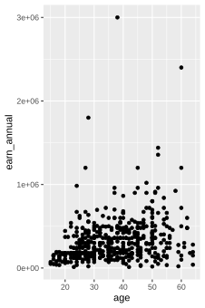
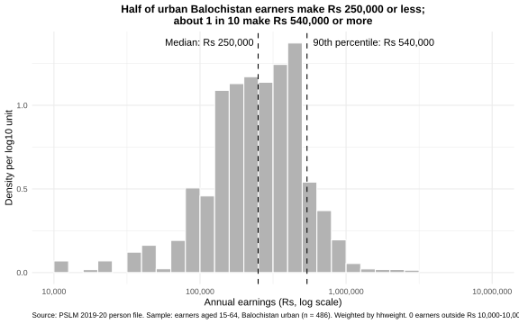
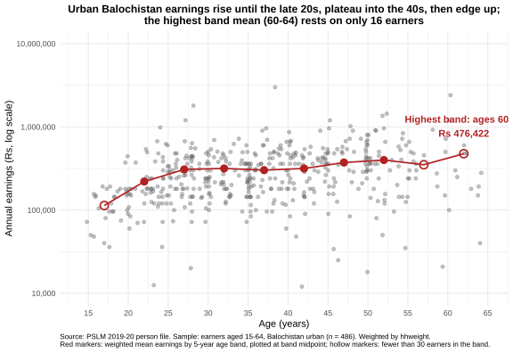
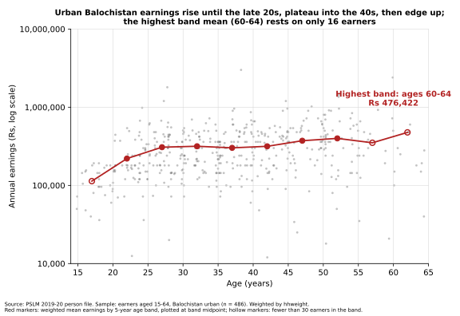

# ECO346-A1-FA24-BED-095
# ECO346 Assignment 1: Earnings and age in urban Balochistan

**Name:** Syeda Quratulain Fatima | **Reg No:** FA24-BED-095 | **Section:** A
**Variant:** 95 = 11 x 8 + 7, so variant 7: Balochistan urban (prov_code 4, urban_rural 2).
**Data:** PSLM 2019-20 person file merged with the household file by hhid. Sample: earners aged 15-64 with earn_annual > 0 (n = 486). All statistics weighted by hhweight.

## How to run
Open a terminal in the repository folder and run, in this order:

    Rscript scripts/01_default.R
    Rscript scripts/02_distribution.R
    Rscript scripts/03_relationship.R
    python scripts/04_band_table_python.py

00_prepare.R is run by the R scripts. 03 writes output/band_table_R.csv, which 04 compares against, so run 03 before 04.

Needs: R packages tidyverse, svglite, scales; Python packages pandas, numpy, matplotlib. No internet is needed after installation.

## Figures

## Q2 Results
Earnings are right-skewed. Of 486 earners in urban Balochistan, about 80% fall between Rs 96,000 and Rs 540,000, with a thin tail of high earners (P90/P10 = 5.625). The weighted median (Rs 250,000) is slightly below the unweighted median (Rs 264,000), because the weights give somewhat more voice to lower-earning households. The gap is only about 5%, so weighting shifts the middle modestly.

## Band table (weighted by hhweight)
| Band | Earners | Weighted mean (Rs) |
|---|---|---|
| 15-19 | 22 (thin) | 113,382 |
| 20-24 | 56 | 220,435 |
| 25-29 | 69 | 307,994 |
| 30-34 | 62 | 316,659 |
| 35-39 | 80 | 302,071 |
| 40-44 | 60 | 316,147 |
| 45-49 | 47 | 372,723 |
| 50-54 | 55 | 399,250 |
| 55-59 | 19 (thin) | 350,772 |
| 60-64 | 16 (thin) | 476,422 |

Highest weighted mean: 60-64 (Rs 476,422, 16 earners, so unreliable).

## Q3 Results
Average earnings rise steeply from about Rs 113,000 at ages 15–19 to about Rs 308,000 at 25–29, consistent with skills and experience being rewarded. They plateau near Rs 300,000–317,000 through the early 40s, then edge up to about Rs 400,000 at 50–54. The highest band, 60–64 (Rs 476,422), rests on only 16 earners, so I treat it cautiously. The figure cannot tell us how one person's earnings change over a career: it compares different people in 2019–20, so older workers' pay may reflect cohort differences, not ageing.

## Q4 Results
I made five changes to the default:
1) Log scale: earnings are right-skewed, so in the default a few earners near Rs 3,000,000 squash most points into the bottom; on the log axis equal distances mean equal percentage differences.
2) Transparency and horizontal jitter fix overplotting, since ages are whole numbers and points stacked in columns.
3) Weighted band means joined by a line show the conditional mean of earnings given age, read by position on a common scale, the most accurate perceptual channel; hollow markers flag thin bands.
4) A finding title and direct annotation replace variable names and save the reader searching.
5) Rupee labels and no grey background: higher data-ink.
What the default shows that my redesign hides: the true size of the gap between the top earners and everyone else; the log scale compresses that gap.

## Q5 Results
One default that differed: R's geom_jitter shifts points horizontally and vertically unless told otherwise, while matplotlib has no jitter. I set width = 0.4, height = 0 in R and added uniform horizontal noise of ±0.4 years, with a fixed seed, in Python, so earnings stay untouched. I also set right=FALSE in both languages' cut functions so a 20-year-old falls in 20–24 in both. Result: 25–29 mean is Rs 307,994 in both.